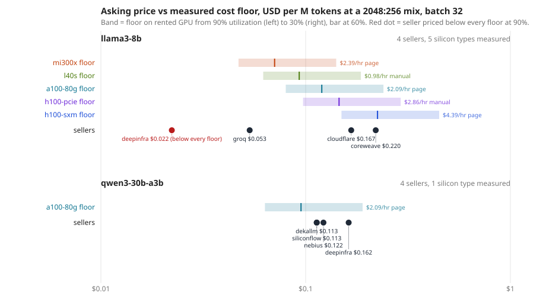

# token-margin

Asking price vs measured cost floor for open-weight inference. Joins two instruments:
[tokenprice](https://github.com/SidScott1410/tokenprice) (what sellers ask, hourly, with provenance)
and [reckon](https://github.com/reckonresearch/reckon) (what a token costs to produce on real silicon,
measured). Pre-registered in [HYPOTHESIS.md](HYPOTHESIS.md); findings in [RESULTS.md](RESULTS.md).

Phase 1 headline: two of four Llama 3.1 8B sellers price below the cost floor of rented
GPUs at any batch size. Their prices are consistent only with owned hardware amortized at
roughly $0.75 to $1.00 per GPU-hour.



*Bands: cost floor on a rented GPU at the headline cell (batch 32, 2048:256 mix) from 90% utilization
(left edge) to 30% (right edge), bar at 60%. Dots: sellers at the same mix. Red: below every floor at 90%.
GPU rates and their provenance are labeled on each band. `python figure.py` regenerates it.*

```
python margin.py              # results/floors.csv, margins.csv, summary.csv
python margin.py --u 0.9      # utilization sensitivity
python figure.py              # results/figure1.svg
```

`prices.yaml` holds every GPU rate with provenance (paid billing export or dated list price).
`data/` holds the corpus snapshot and the tokenprice snapshot used, so the run is reproducible
without network.

Phase 2: measure gpt-oss-120b and qwen3.6-35b-a3b on the reckon harness (one H100 each)
to move from n = 4 sellers to n = 26 and n = 10.

License: Apache-2.0 (code), CC BY 4.0 (results and data snapshots).
